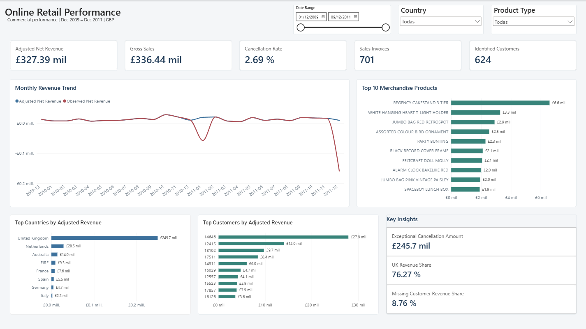
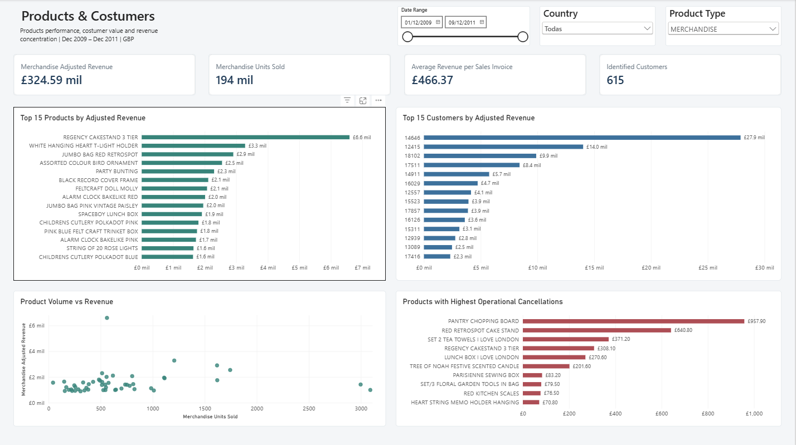
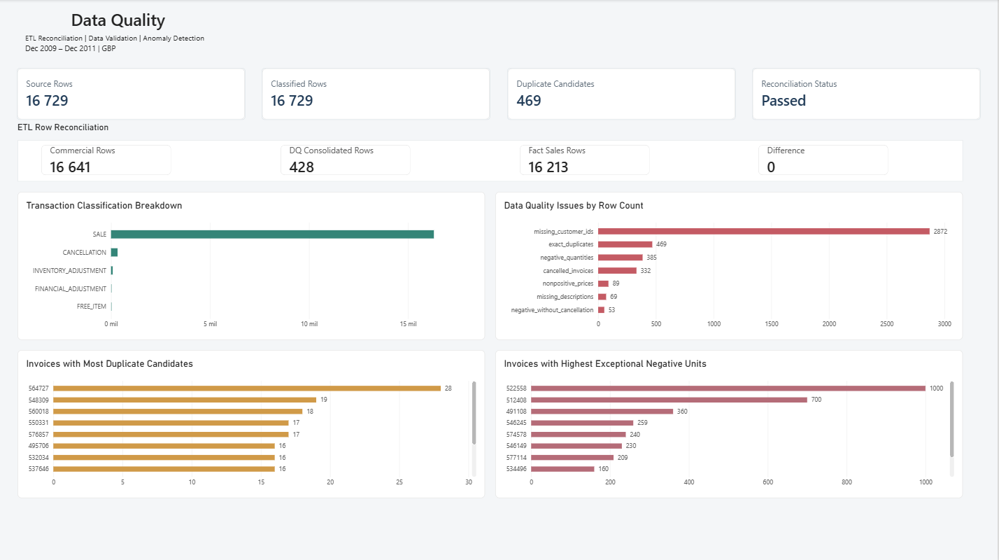

# Online Retail Analytics

**End-to-End Data Analytics Project | Python · SQL Server · Power BI**

## Project Overview

Online Retail Analytics is an end-to-end data analytics project designed to transform transactional retail data into actionable business insights.

The project implements a data pipeline covering source-data profiling, data quality assessment, transaction classification, analytical consolidation, SQL Server data warehousing, and interactive Power BI reporting.

The analysis focuses on commercial performance, product and customer behavior, exceptional cancellations, and data reliability.

## Technology Stack

- **Python:** pandas, data transformation, profiling, and validation
- **SQL Server:** staging, dimensional modeling, stored procedures, and analytical views
- **Power BI:** data modeling, DAX measures, and interactive dashboards
- **pytest:** automated pipeline testing
- **Git & GitHub:** version control and project documentation

## Key Business Results

| Metric | Result |
|---|---:|
| Gross Sales | £336,438.69 |
| Observed Net Revenue | £81,738.56 |
| Adjusted Net Revenue | £327,391.76 |
| Operational Cancellation Rate | 2.69% |
| Commercial Invoices | 837 |
| Identified Customers | 624 |
| Countries Represented | 20 |

**Important:** Adjusted Net Revenue excludes two exceptional, unmatched cancellation lines totaling £245,653.20. Both records remain preserved in the dataset and in Observed Net Revenue. Adjusted Net Revenue is an operational analytical measure, not audited accounting revenue.

## Data Pipeline

The pipeline follows five principal stages:

1. **Source Profiling:** validate the input schema, analyze missing values, and calculate a SHA-256 source checksum.
2. **Data Quality Assessment:** identify duplicate candidates, missing identifiers, unusual quantities, and nonpositive prices.
3. **Transaction Transformation:** classify transactions as sales, cancellations, free items, inventory adjustments, or financial adjustments.
4. **Analytical Consolidation:** aggregate commercial transaction lines while preserving source lineage and reconciling quantities and amounts.
5. **Data Warehouse Loading:** load the analytical dataset into SQL Server staging and a dimensional model.

The warehouse load uses SQL transactions, reconciliation checks, and rollback handling to protect against incomplete loads.

## Data Quality and Reconciliation

| Reconciliation Metric | Result |
|---|---:|
| Original Source Rows | 16,729 |
| Classified Rows | 16,729 |
| Commercial Rows | 16,641 |
| Non-Commercial Adjustment Rows | 88 |
| Rows Reduced Through Consolidation | 428 |
| Final FactSales Rows | 16,213 |
| Unexplained Row Difference | 0 |
| Quantity Difference | 0 |
| Amount Difference | £0.00 |

The pipeline identified 469 rows belonging to potential exact-duplicate groups. These rows are flagged rather than automatically removed because the source lacks unique invoice-line identifiers.

Additional controls verify that the SQL Server fact table matches the ETL's expected record count, quantity, and monetary totals.

## Download the Power BI Template

The interactive report is available as a Power BI template:

**[Download Power BI Template (.pbit)](powerbi/Online_Retail_Analytic.pbit)**

The template includes three report pages:

- Executive Overview
- Products & Customers
- Data Quality

The original Power BI Desktop file (.pbix) is not distributed.

### Opening the Template

1. Download the `.pbit` file.
2. Open it with Microsoft Power BI Desktop.
3. Configure the `SQLServer` parameter for your SQL Server instance.
4. Configure `SQLDatabase` for your database.
5. Configure `ProjectDataPath` to point to the processed ETL output directory.
6. Provide access to the required SQL Server tables and local analytical files.
7. Refresh the data model.

**Note:** The template does not include the original dataset or a populated data model. Reproducing the report requires preparing the underlying data and database.

## Power BI Dashboard

The reporting solution contains three pages:

### Executive Overview

Provides business-level performance indicators, adjusted revenue trends, geographic performance, and cancellation analysis.



### Products & Customers

Explores merchandise performance, leading customers, sales distribution, product volume, and cancellation patterns.



### Data Quality

Presents transaction classification, quality findings, duplicate candidates, exceptional negative quantities, and ETL reconciliation indicators.



## Selected Analytical Findings

- October 2010 recorded the highest adjusted monthly revenue in the available sample, at £28,163.24.
- REGENCY CAKESTAND 3 TIER was the leading merchandise product, generating £6,590.99 in adjusted revenue.
- Customer 14646 generated £27,889.30 in adjusted revenue.
- The United Kingdom accounted for approximately 76.3% of adjusted revenue.
- Missing customer identifiers affected customer-level analytical coverage but did not automatically invalidate commercial transactions.

## Automated Testing

The project includes automated pytest tests covering transaction classification, duplicate identification, analytical consolidation, reconciliation controls, and SQL Server loading utilities.

**Latest verified test run:** 16 passed, 1 non-failing cache warning.

Run tests using:

```powershell
python -m pytest tests/ -v
```

## Data Warehouse

The warehouse uses a star schema with `dw.FactSales` and supporting date, product, customer, country, and transaction-type dimensions.

SQL scripts support database creation, dimensional modeling, ETL procedures, business reporting views, exception analysis, and product-type classification.

## Dataset Origin and Limitations

The project uses a prepared sample of 16,729 transaction records spanning December 2009 through December 2011.

The original provenance and synthetic-versus-real status of the records have not been independently established. Therefore, the sample should not be represented as a complete or verified historical record of a retailer.

The dataset also lacks unique invoice-line identifiers, and certain cancellations cannot be reconciled to corresponding positive sales within the available sample.

These limitations are explicitly addressed in the analysis and reporting methodology.

## Project Documentation

Detailed methodology and findings are available in:

- `docs/data_quality_rules.md`
- `docs/analytical_findings.md`
- `docs/business_findings.md`

## Installation and Reproducibility

### Requirements

- Python 3.13
- Microsoft SQL Server
- Microsoft ODBC Driver 18 for SQL Server
- Power BI Desktop
- Windows integrated authentication for the default local setup

### 1. Prepare the Python environment

```powershell
python -m venv .venv
.\.venv\Scripts\Activate.ps1
python -m pip install -r requirements.txt
```

### 2. Provide the source dataset

Create `data/raw/` and place a compatible Excel workbook at:

`data/raw/online_retail_transactions_raw.xlsx`

The workbook must contain a worksheet named `transactions_raw` with the expected transaction columns.

**The source dataset is not distributed with this repository.**
Its original provenance and redistribution rights have not been independently verified.

### 3. Run the Python ETL

From the project root:

```powershell
python src/profile_data.py
python src/inspect_quality_issues.py
python src/transform_transactions.py
python src/build_analytical_dataset.py
```

These scripts generate profiling, quality-review, classified transaction, and analytical output files.

### 4. Prepare SQL Server

Connect to your SQL Server instance using SQL Server Management Studio.

Execute these scripts in order:

1. `sql/01_create_database.sql`
2. `sql/02_create_star_schema.sql`
3. `sql/03_create_load_procedure.sql`

Ensure subsequent scripts execute against `OnlineRetailAnalytics`.

### 5. Load the data warehouse

Configure the connection if your environment differs from the local defaults:

```powershell
$env:ONLINE_RETAIL_SQL_SERVER = "localhost"
$env:ONLINE_RETAIL_SQL_DATABASE = "OnlineRetailAnalytics"
$env:ONLINE_RETAIL_ODBC_DRIVER = "ODBC Driver 18 for SQL Server"
```

Run:

```powershell
python src/load_sql_server.py
```

The loader uses Windows authentication by default. Local development settings should not be assumed appropriate for production.

### 6. Create analytical views

After loading the warehouse, execute:

1. `sql/04_create_analytics_views.sql`
2. `sql/05_create_exception_analysis_views.sql`
3. `sql/07_classify_product_types.sql`

`sql/06_business_analysis.sql` provides additional analysis queries.

`sql/08_remove_unknown_date.sql` is an optional migration for an existing warehouse and is not required for initial installation.

### 7. Open the Power BI template

Open [Online_Retail_Analytic.pbit](powerbi/Online_Retail_Analytic.pbit) in Power BI Desktop.

Configure:

- `SQLServer`: the SQL Server instance
- `SQLDatabase`: the warehouse database
- `ProjectDataPath`: the absolute path to `data/processed`

Refresh the model after the SQL tables and ETL output files are available.

### 8. Run automated tests

```powershell
python -m pytest tests/ -v
```

The development environment previously reported 16 passing tests.

### Reproducibility limitations

The complete workflow has been validated in the development environment,
but independent reproduction on another machine has not yet been verified.
Different source data may produce different results, and the published
template does not include a populated model.

## Project Status

Core data processing, warehouse reconciliation, automated testing, and the three Power BI report pages have been completed and validated in the development environment.

Repository publication and independent reproduction testing remain pending.